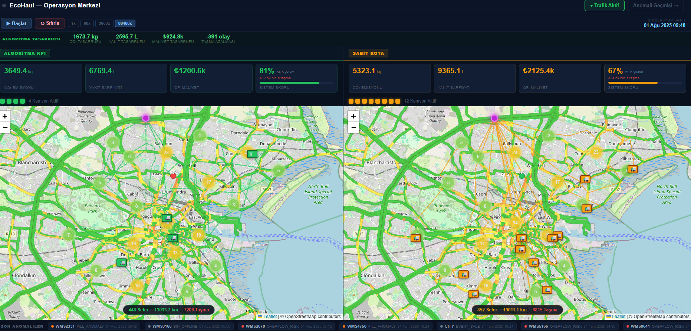

# EcoHaul

IoT-assisted waste collection and route-planning simulation developed as a graduation project. EcoHaul connects ESP32 telemetry, a geospatial API, and an interactive dashboard to explore collection efficiency and overflow risk.



## Features

- React + Leaflet dashboard with bin locations, truck movement, anomaly history, KPI comparison, and CSV export.
- FastAPI REST endpoints for device state changes, heartbeats, and simulation controls.
- PostgreSQL/PostGIS storage for bin coordinates, telemetry, and anomaly events.
- DPET dynamic dispatch using fill level, estimated time to overflow, traffic heuristics, proximity, and local density; nearest-neighbor routing and 2-opt refinement.
- Comparative routing implementations: LO-DCS, K-means + ACO, and improved HHO. These are project adaptations; implementation notes and references are in each module.
- Geographic clustering and rolling cycle averages for fill-time estimation.
- ESP32 + HC-SR04 firmware with median filtering, enum-based state changes, heartbeats, and deep sleep.
- CSV cleaning, coordinate conversion to WGS84, validation, and database loading scripts.

## Architecture

```text
ESP32 / HC-SR04 -> FastAPI -> PostgreSQL / PostGIS
                       |             |
                       +-> simulation engine -> React / Leaflet dashboard
Dataset CSV -> cleaning -> WGS84 -> database
```

## Run locally (PowerShell)

Prerequisites: Python 3.12, Node.js 20+, and PostgreSQL with PostGIS. Create an empty database named `ecohaul`; the database role must be able to enable PostGIS or an administrator must enable it first.

```powershell
python -m venv .venv
.venv/Scripts/python.exe -m pip install -r backend/requirements.txt
Copy-Item backend/.env.example backend/.env
Copy-Item frontend/.env.example frontend/.env
```

Set `DATABASE_URL` in `backend/.env` to your local database credentials. Then, from the repository root:

```powershell
.venv/Scripts/python.exe backend/scripts/clean_bins.py
.venv/Scripts/python.exe backend/scripts/transform_bins_to_wgs84.py
.venv/Scripts/python.exe backend/scripts/validate_bins.py
.venv/Scripts/python.exe backend/scripts/load_bins_to_db.py
.venv/Scripts/python.exe backend/scripts/label_bins.py
```

The label step adds the `fill_label` and `distance_label` columns required by simulation startup. Generated data stays local under `backend/data/`.

Start the API in one terminal:

```powershell
cd backend
../.venv/Scripts/python.exe -m uvicorn app.main:app --reload --host 127.0.0.1 --port 8000
```

Start the dashboard in another terminal:

```powershell
cd frontend
npm ci
npm run dev
```

Open the Vite URL printed in the terminal (normally `http://localhost:5173`). The simulation is the home page; anomalies are at `/anomalies`. API documentation: `http://localhost:8000/docs`. Load the database before starting the API; restart the API after importing data.

## ESP32 setup

Copy `ESP32-Sensor/config.example.h` to `ESP32-Sensor/config.local.h`, configure Wi-Fi and your computer's LAN address, and upload `ESP32-Sensor.ino` using the ESP32 Arduino toolchain. For a device on the local network, bind the API to `0.0.0.0` and allow the port on your local firewall. Keep device testing on a trusted local network. Firmware compilation and physical sensor calibration require the board/toolchain.

## Verification

```powershell
python -m compileall -q backend/app backend/scripts
python -m unittest discover -s backend/tests -v
cd frontend
npm run build
```

The dependency-free tests cover route coverage, deterministic algorithm seeds, and fill prediction. A frontend build does not verify a live database or real sensor behavior.

## Interpretation and limitations

This is a research/demo prototype. The dataset supplies geographic bin locations; fill rates, district behavior, traffic multipliers, fuel consumption, emissions, and cost are modeled assumptions. The simulation uses geographic distance rather than a road-network travel-time matrix. Reported savings are scenario outputs, not demonstrated municipal operating savings.

The predictor uses geographic clustering and rolling averages; it is not a trained deep-learning model. Independent seeded scenarios and repeated trials are still needed for robust algorithm comparisons. ACO and HHO have dynamic dispatch behavior despite the internal `fixed` world name.

API endpoints currently have no authentication. Public source sharing does not mean the API is ready for public hosting. Before hosting, add device authentication, restricted CORS, rate limits, input bounds, and production error handling. `VITE_*` variables are browser-visible; never place secret server credentials there. The older `App.jsx` map/road-preview screen is not mounted by `main.jsx` and needs integration work before use.

## Repository guide

- `backend/app/`: API, simulation, prediction, and routing algorithms.
- `backend/scripts/`: dataset preparation and import.
- `frontend/src/`: dashboard and anomaly UI.
- `ESP32-Sensor/`: device firmware and example local configuration.
- `dataset/`: supplied Dublin bin-location CSV.
- `progress docs/`, `dosyalar/`: development notes and project documents.
- [Project review and CV examples](docs/PROJECT_REVIEW_TR.md).

## Data and attribution

The supplied CSV is identified in the project as Dublin City Council public bin locations. The repository does not currently establish its exact source URL or redistribution license; verify and record those before reusing or redistributing the data elsewhere. Algorithm source references and adaptation notes are recorded in `lo_dcs.py`, `aco_route.py`, and `hho_route.py`. No additional license grant is made for third-party material.
